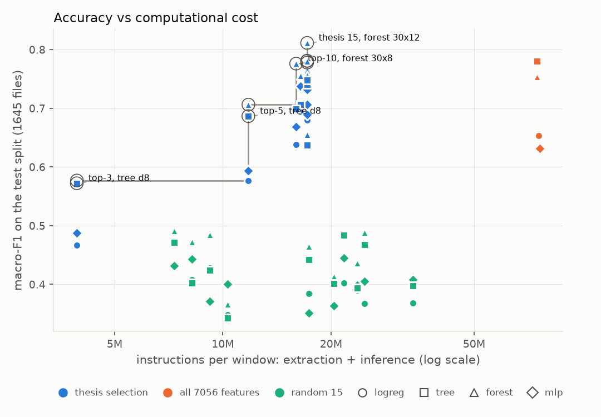

# HIF fault locator on a microcontroller

Runs a high-impedance-fault (HIF) region locator as **real firmware** on a **simulated ARM
Cortex-M4F** (STM32F407 in [Renode](https://renode.io)): feature extraction and model inference in
C, measured for flash, RAM, stack and executed instructions across configurations.

The features come from the undergraduate thesis *Feature Selection for Region Locating of High
Impedance Faults* (UFMG). It ranks 15 substation-measurable features, taken from 7056 candidates
built on DFT, Stockwell and wavelet transforms, for locating an HIF in one of four regions of an
adapted IEEE 34-node feeder. This project asks what those features cost on a device, compared with
using all of them or random subsets of the same size.

> **Status: work in progress.** Done: toolchain, bare-metal firmware running in Renode, a Python
> reference that reproduces the thesis's features exactly, four models converted to C that agree
> 100% with scikit-learn on the simulated board, C feature extraction (DFT, Stockwell,
> wavelet on CMSIS-DSP) matching the reference on every test window, the full pipeline
> (raw window -> features -> model) agreeing 100% with scikit-learn on the simulated board, a
> measurement harness, and an 80-configuration sweep over feature sets, models and compiler
> settings, every point verified on the simulated device, and the report
> (`report/relatorio.tex` in Portuguese, `report/report.tex` in English).

## Main results



- The thesis's 15 features (selected on the training split only) beat every one of 10 random
  15-feature sets with every model: forest macro-F1 0.781 against a random best of 0.491.
- Using all 7056 features costs 4.4x the instructions per window (74.8 M vs 17.2 M) and buys no
  accuracy (forest 0.754, tree 0.780).
- Feature extraction dominates: inference is under 0.07% of the instructions per window with
  15 or fewer features, and at most 1.7% (the MLP on all 7056). Within extraction, the wavelet
  transform costs most.
- Flash is set by the model (forest 30 x depth 8: 113 KB; tree: 4 KB), RAM and compute by the
  features. Every configuration's firmware fits the STM32F407 (all 7056 features only with
  its 64 KB CCM) and none fits a 32 KB Cortex-M0+; a real device would also need RAM for the
  raw window (120-140 KB), which does not fit next to it.

More: [accuracy vs flash](results/plots/f1_vs_flash.png),
[cost split](results/plots/cost_split.png), [board fit](results/plots/boards.png),
[full table](results/sweep.md).

## How it fits together

```
 Python (PC)                                    C firmware (simulated Cortex-M4F)
 thesis data -> features.py -> model            raw window (test vector)
                    |             |                    |
                    |             +-- convert --> model.h --> prediction
                    +-- port ----------------> features.c (CMSIS-DSP)
 test windows ------------------------------> test_vectors.h
                                                       |
       compare features and predictions  <------- UART output
```

Every C function has a Python reference, and features and predictions are compared on every test
vector before any measurement is reported.

## Layout

```
python/      feature reference, split, selection, models, baseline
firmware/    src/ (startup, UART, main), include/ (generated headers), linker.ld, Makefile,
             third_party/ (CMSIS-DSP v1.18.0, CMSIS_6 v6.4.0 as submodules)
renode/      .resc script and Robot Framework tests
results/     tables and plots
report/      write-up, including report/features.md (exact feature definitions)
```

## Setup

```bash
git clone --recurse-submodules <this repo>     # or: git submodule update --init --depth 1

python3 -m venv .venv && .venv/bin/pip install -r requirements.txt
```

- **ARM compiler:** `sudo apt install gcc-arm-none-eabi`, or the Arm GNU Toolchain tarball from
  developer.arm.com (developed with 14.3.rel1).
- **Renode:** 1.17.0 or newer from the [releases page](https://github.com/renode/renode/releases).
  `renode-test` also needs the Python packages listed in Renode's `tests/requirements.txt`.
- **Thesis data:** the Python side reads the thesis repository (feature matrices, raw simulations,
  selection code). Point `HIF_THESIS` at it if it is not at the default path in `python/paths.py`.

## Usage

```bash
# Firmware
make -C firmware                      # -> firmware/build/hif.elf
make -C firmware size                 # flash / RAM usage
renode renode/hif.resc                # run with a UART window
renode-test renode/hello.robot        # headless boot check

# Python (data/ is derived and not versioned)
.venv/bin/python python/make_split.py        # fixed train/test split, grouped by soil
.venv/bin/python python/export_windows.py    # raw test windows + parity check vs the thesis
.venv/bin/python python/select_train.py      # thesis selection re-run on the training split
.venv/bin/python python/baseline.py          # models x feature sets on the test split
.venv/bin/python python/convert.py --model forest   # train + firmware/include/model.h + host check
.venv/bin/python python/run_device.py model  # that model on the simulated board, all test rows
.venv/bin/python python/run_device.py host   # C features (PC build) vs python, all test windows
.venv/bin/python python/run_device.py features   # C features on the simulated board, 120 windows
.venv/bin/python python/run_device.py full   # whole pipeline on the board: features + prediction
.venv/bin/python python/measure.py --opt -Os # flash, RAM, stack, instructions -> results/measurements.csv
.venv/bin/python python/sweep.py --workers 4 # all 80 configurations -> results/sweep.csv (~1 h)
.venv/bin/python python/plots.py             # results/plots/*.png, results/sweep.md
.venv/bin/python python/report_figures.py    # report figures (Portuguese and English)
cd report && latexmk -pdf relatorio.tex      # the report (Portuguese)
cd report && latexmk -pdf report.tex         # the report (English)
.venv/bin/python -m pytest python -q         # reference vs pywt / scipy / thesis code
```

## Method notes

- **Fixed split:** 7 of 34 HIF soil models are held out, giving 6345 train and 1645 test
  simulations at 40 dB SNR. Holding out whole soils keeps one arc waveform from appearing on
  both sides.
- **Selection on training data only:** the thesis published its ranking from all simulations, so
  it is re-run here, with the same code and configuration, on the training soils alone.
- **Reference parity:** `python/features.py` reproduces the thesis's 7056 features to float32
  rounding (max relative error 6.9e-8) on all 1645 test simulations.
- **Feature extraction in C:** CMSIS-DSP only offers power-of-two FFTs, so the 2560-sample
  (10-cycle) transforms are built from ten 256-point FFTs, and the Stockwell voices are reduced
  to a closed form that needs no inverse FFT (`python/fast.py` is its numpy twin).
- **Instruction counts are not time:** Renode is a functional simulator. Counts (exact, via a CPU
  hook) compare configurations; they ignore pipeline stalls, flash wait states and memory
  latency. See `report/measurement.md`.
